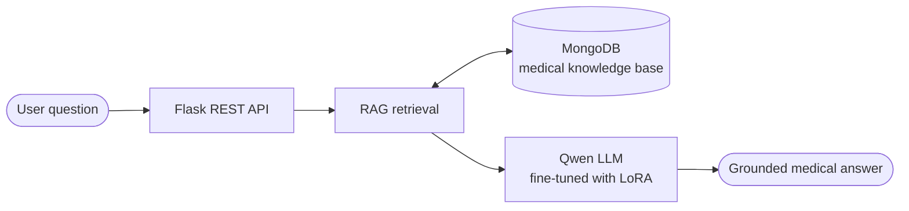
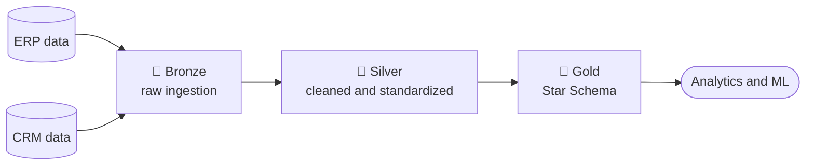

<!-- ===================== HEADER ===================== -->

  

  

  
  
  

  
  
  

---

## 👨‍💻 About Me

I'm an **AI Engineer and Data Engineer** and a **Computer Science graduate of Tanta University (2026)**. I build practical, well-structured systems: from **LLM-powered applications** and **machine learning models** to **ETL pipelines**, **data warehouses**, and **scalable REST services**.

I like turning theory into real applications that are understandable, maintainable, and easy to deploy, and every project below ships as a working, containerized service rather than just a notebook.

| | |
|---|---|
| 🎓 **Education** | B.Sc. Computer Science, Faculty of Computer Science & IT, Tanta University (2026) |
| 🧠 **Currently** | AI & Machine Learning Training at the National Telecommunication Institute (NTI) |
| 🎯 **Preparing for** | Huawei International Certification Exam (AI Track) |
| 🗣️ **Languages** | Arabic (Native) · English (Conversational) |
| 📫 **Reach me** | [adeldevj@gmail.com](mailto:adeldevj@gmail.com) · [LinkedIn](https://www.linkedin.com/in/adel-muhammad) |

---

## 🔭 What I'm Focused On

- 🤖 **Generative AI:** fine-tuning LLMs with **LoRA** and building **RAG** pipelines that ground answers in trusted knowledge
- 🏗️ **Data Engineering:** ETL pipelines, data warehousing (**Medallion Architecture**, **Star Schema**), and data modeling
- ⚙️ **Backend & Deployment:** scalable REST APIs documented with Swagger and deployed with **Docker**
- 👁️ **Computer Vision & Deep Learning:** CNN, transfer learning (VGG, ResNet), object detection with YOLO

---

## 🚀 Featured Projects

| Project | What it does & impact | Stack |
|:--|:--|:--|
| 🩺 **[Medical Chatbot](https://github.com/adel-dev11/medchatbot-live-demo)** | Domain-specific medical Q&A. A **Qwen** LLM fine-tuned with **LoRA**, plus a **RAG** pipeline that grounds answers in a medical knowledge base, with security mechanisms for safer responses. Deployed as a containerized REST API. | `Python` `Flask` `Qwen` `LoRA` `RAG` `MongoDB` `Docker` |
| 🛡️ **[LicenseGuard Pro](https://github.com/adel-dev11/live-demo-AI-licenses)** | Analyzes a project's `package.json`, enriches every dependency through **live npm registry calls**, and uses an ML classifier to flag risky licenses (GPL / LGPL / MIT) with replacement recommendations. Documented REST API with **Swagger UI**, deployed on Railway. | `Python` `Flask` `Scikit-learn` `REST API` `Docker` `Railway` |
| 🏦 **[SQL Data Warehouse & Analytics](https://github.com/adel-dev11/SQL-data-warehouse-project)** | Data warehouse built on **Medallion Architecture** (Bronze / Silver / Gold) with a **Star Schema**. ETL pipelines process **300 GB+ of monthly ERP and CRM data** and **cut data duplication by 30%**. | `SQL Server` `T-SQL` `ETL` `Data Modeling` |
| 📈 **[Risk Assessment AI Tool](https://github.com/adel-dev11/Risk-Assessment)** | Green Bonds financial risk analysis with automated preprocessing and data-quality validation, **ARIMA time-series forecasting**, ML classifiers, and interactive dashboards. | `Python` `Flask` `Pandas` `ARIMA` `Chart.js` |
| 📧 **[Spam Email Detector](https://github.com/adel-dev11/spam-detector)** | **Bilingual (Arabic / English)** spam detection using **Isolation Forest** anomaly detection and a TF-IDF text pipeline, with **no labeled data required**. | `Python` `Flask` `NLP` `Scikit-learn` `TF-IDF` |

<b>🧩 See how two of these systems are designed</b>

 

**Medical Chatbot: RAG + LoRA fine-tuned LLM**

**SQL Data Warehouse: Medallion Architecture**

---

## 🛠️ Tech Stack

**Languages**

**AI / Machine Learning**

**Data Engineering & Databases**

**Backend & DevOps**

---

## 💼 Experience & Training

| Period | Role | Highlights |
|:--|:--|:--|
| **Sep 2025 – Present** | **AI & Machine Learning Training** National Telecommunication Institute (NTI) | Intensive deep learning training with **TensorFlow / Keras**: ANN, CNN, and **transfer learning (VGG, ResNet)** applied to real image-classification projects. |
| **Jun 2025 – Aug 2025** | **Data Science Intern** CIB (Commercial International Bank) | Exploratory data analysis and predictive analytics on **real banking datasets**, supporting risk assessment and sustainable-finance decisions. |
| **Nov 2024 – Jun 2025** | **Families Committee President** Students' Union Council, Tanta University | Organized **5+ workshops** and a **job fair connecting 200+ students** with employers. |

---

## 📊 GitHub Activity

  
  

  

  

---

## 🤝 Let's Connect

I'm open to **AI Engineer, Machine Learning Engineer, and Data Engineer** opportunities, and always happy to talk about LLMs, data platforms, or collaborating on something useful. Feedback on my repositories is very welcome.

  
  

  

